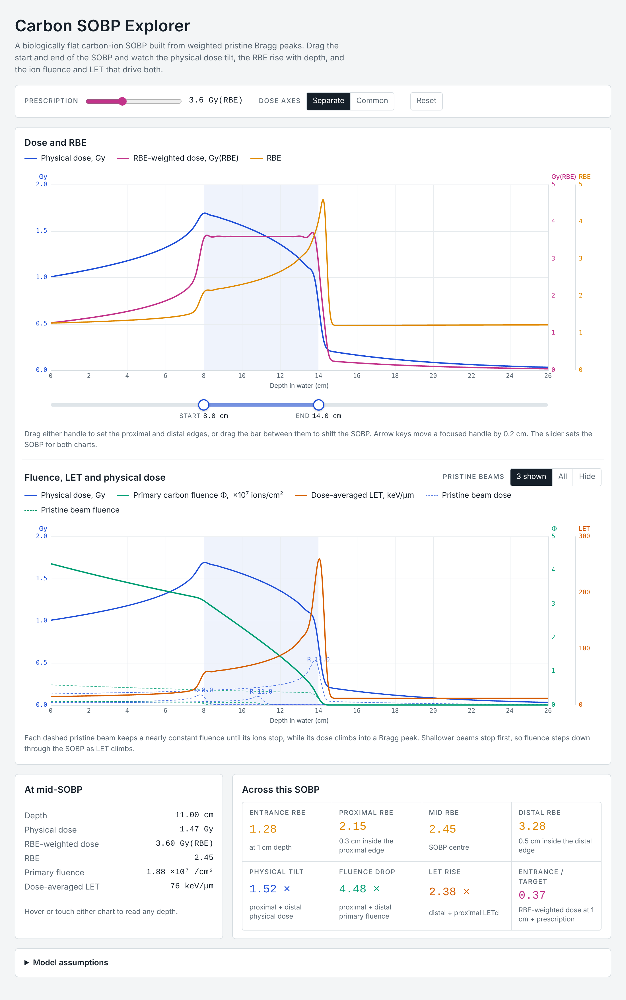

# Carbon SOBP Explorer

An interactive teaching model of a carbon-ion spread-out Bragg peak (SOBP). Drag the proximal and distal edges of the SOBP and watch how the physical dose, RBE-weighted dose, RBE, primary ion fluence and dose-averaged LET re-balance with depth.

**Live page:** https://hungrueichen.github.io/carbon-sobp-explorer/

## What it shows

- **Dose and RBE:** physical dose (Gy), RBE-weighted dose (Gy(RBE)) and RBE versus depth in water. Peak weights are solved so the RBE-weighted dose is flat across the SOBP, which forces the physical dose to slope downward.
- **Fluence, LET and physical dose:** primary carbon fluence (ions/cm²), dose-averaged LET (keV/µm) and the weighted pristine beams that sum to the SOBP. Each pristine beam keeps a nearly constant fluence until its ions stop, so fluence steps down through the SOBP while LET climbs.
- **Controls:** SOBP start and end (shared depth slider), prescription per fraction, separate or common dose axes, and 3 / all / no pristine beams.
- **Readouts:** values at any depth on hover, plus entrance, proximal, mid and distal RBE, physical tilt, fluence drop and LET rise across the SOBP.

## Model

This is a toy model for teaching, not a treatment planning calculation. The directions of change are the point; absolute values are illustrative.

- **Pristine peaks:** Bragg–Kleeman stopping power `S ∝ (R − z)^(1/p − 1)` with `p = 1.77`, Gaussian range straggling widened by a ripple filter (σ ≈ 0.2 cm), primary fluence attenuated as `exp(−z / 28 cm)`.
- **Fragments:** dose builds up with depth as primaries are lost and continues past each peak as an exponential tail, with a fixed fragment LET of 12 keV/µm.
- **Fluence:** primary carbon ions only, from `Φ = D / (1.602×10⁻⁹ · LET)` (Gy, keV/µm, ions/cm², water). Fragment fluence is not plotted, although fragment dose and LET are included in the dose and LETd curves.
- **Biology:** HSG-like reference cells, photon α = 0.313 Gy⁻¹ and β = 0.0615 Gy⁻². Carbon α rises with dose-averaged LET above 8 keV/µm with an overkill roll-off; β is held equal to the photon value. RBE is solved from linear-quadratic isoeffect at the local physical dose, so it also depends on dose per fraction.
- **Optimisation:** non-negative, lightly smoothed least-squares fit of pristine-beam weights, iterated with the LET-dependent RBE until RBE × physical dose is flat across the SOBP.

## Running locally

The page is a single self-contained `index.html` with no build step. Open it in any modern browser. Fonts load from Google Fonts and fall back to system fonts offline.
